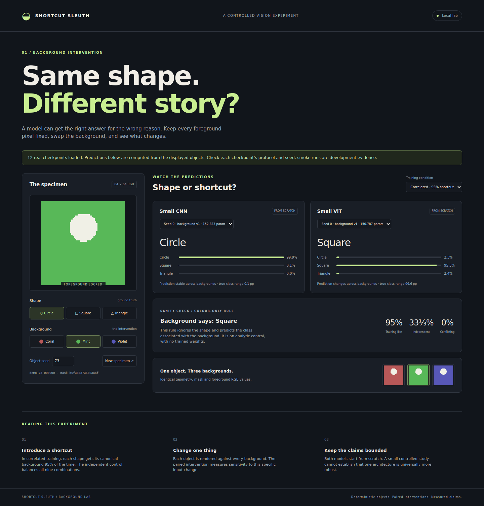
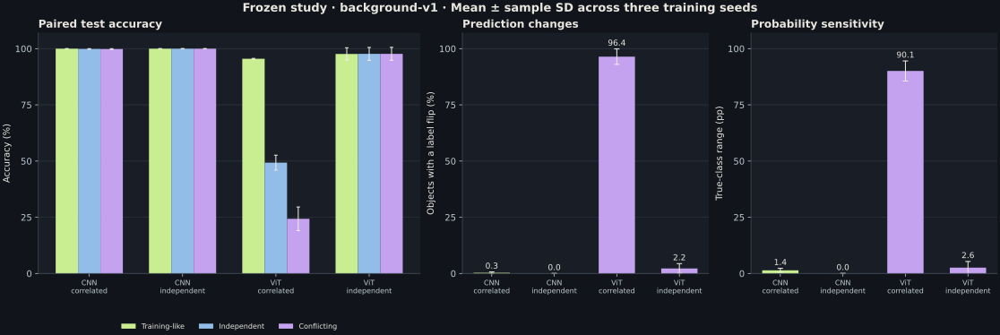

# Shortcut Sleuth

**Did your model learn the shape—or the background?**

A controlled CNN vs. Vision Transformer experiment with an interactive background-swap lab. Train both models from scratch, keep each foreground pixel fixed, and measure what happens when the background shortcut changes.

**Status:** the complete 12-run study is trained, evaluated and verified. The interactive lab has been checked with all 12 checkpoints on desktop and mobile. [Frozen configuration](configs/frozen-v1.json) · [Measured results](results/background-v1/REPORT.md) · [Verification and limitations](docs/RESULTS.md).

<p align="center"></p>

*Actual seed-0 correlated checkpoints, object `demo-73-000000`, with only its background changed. [Canonical-background capture](results/browser-study/lab-desktop.png) · [Mobile capture](results/browser-study/lab-mobile.png) · [Paired renderer examples](results/paired-examples.png).*

## Features

- Versioned, deterministic 64 × 64 RGB rendering, exact background allocation and hash-checked split isolation.
- Small CNN and patch-based ViT, random initialisation, one shared training recipe and matched data orders.
- Correlated training (95% canonical backgrounds) and an independent-background control.
- Paired evaluation: weighted accuracy, nine-group accuracy, worst-group accuracy, flip rate and true-class probability range.
- Per-object predictions, per-seed reports, runtime, environment and checkpoint provenance.
- Local background lab with checkpoint selection, probabilities and paired sensitivity.

The primary comparison uses the frozen three-seed study. Development failures and inconclusive checks are retained alongside successful runs.

## Measured results

Each run evaluates the same 3,000 held-out objects on all three backgrounds. Values are mean ± sample standard deviation across training seeds 0, 1 and 2.

| Model | Training backgrounds | Conflicting-background accuracy | Background flip rate |
| --- | --- | --- | --- |
| CNN | Correlated | 99.83% ± 0.19 | 0.32% ± 0.36 |
| CNN | Independent | 100.00% ± 0.00 | 0.00% ± 0.00 |
| ViT | Correlated | 24.32% ± 5.23 | 96.43% ± 3.44 |
| ViT | Independent | 97.70% ± 2.90 | 2.23% ± 2.17 |

The correlated ViT was strongly sensitive to background changes. Independent-background training reduced that sensitivity. The correlated CNN retained almost all of its accuracy, so the anticipated shortcut collapse did not occur for that model. These findings describe this synthetic task and shared recipe; they do not establish a universal architecture ranking.



[All per-seed metrics and resource measurements](results/background-v1/REPORT.md) · [Nine-group accuracy figure](results/background-v1/groups.svg) · [Training curves](results/background-v1/training-curves.json) · [Prediction and provenance verification](results/background-v1/verification.json).

## Install

Use Python 3.10+ and an isolated environment. Run commands from the repository root. Check free disk space before installing and current GPU use before explicitly selecting a CUDA device.

```bash
python -m venv .venv
source .venv/bin/activate
python -m pip install --upgrade pip
# CPU installation; choose the appropriate PyTorch build for your own hardware.
python -m pip install torch --index-url https://download.pytorch.org/whl/cpu
python -m pip install -e .
```

NumPy and Pillow suffice for data generation, analytic controls and the checkpoint-free interface. PyTorch is required for training and model inference. No pretrained features or external datasets are used. Node.js 22+ is needed only for interface tests.

## Try the lab

```bash
python -m shortcut_sleuth serve
```

Open **http://127.0.0.1:8000**. Without checkpoints, the page exposes exact background swaps and a clearly labelled colour-only rule. CNN and ViT cards explain that trained weights are missing.

To populate those cards:

```bash
python -m shortcut_sleuth smoke --output artifacts/smoke
python -m shortcut_sleuth serve --runs artifacts/smoke/runs
```

The smoke command prepares separate development objects, trains all four model/condition combinations for two epochs, evaluates final checkpoints and writes a Markdown report and SVG figure to `artifacts/smoke/report/`. The [executed smoke report](results/smoke/REPORT.md) retains all four measured outcomes, including the underfit independent controls. Two-epoch scores must not be presented as the main study.

## Verification

```bash
python scripts/verify.py --require-all --output artifacts/verification.json
python -m shortcut_sleuth overfit --output artifacts/overfit.json
```

Verification requires every Python and JavaScript check to execute. The overfit command requires both models to reach 98% accuracy on 27 balanced renders of nine training objects and parameter counts within 20%. This is a learning sanity check, not a generalisation result.

To check a supported subset when PyTorch or local sockets are unavailable, omit `--require-all`; skips remain visible in the JSON record. The [GitHub workflow](.github/workflows/ci.yml) requires all checks, builds the package, runs tiny overfit, executes the smoke pipeline and checks the real browser. Its definition is not evidence of a passing remote run.

For browser verification and reproducible screenshots:

```bash
python -m pip install -e '.[browser]'
python -m playwright install chromium
python scripts/browser_check.py --output artifacts/browser-control
python scripts/browser_check.py --runs artifacts/smoke/runs --output artifacts/browser-smoke
```

Data and controls can also be checked independently:

```bash
python -m shortcut_sleuth prepare --config configs/full.json --output artifacts/data-audit
python -m shortcut_sleuth audit --data artifacts/data-audit --output artifacts/data-audit.json
python -m shortcut_sleuth control
python -m shortcut_sleuth grid --output artifacts/paired-examples.png
```

Published evidence includes **15,600 unique foregrounds, zero cross-split duplicates and 31,200 pixel-exact foreground-swap comparisons**. The colour-only control yields:

| Training-like accuracy | Independent accuracy | Conflicting accuracy | Background flip rate |
| --- | --- | --- | --- |
| 95% | 33⅓% | 0% | 100% |

These validate the intervention and metrics; they are not trained-model results. See [data-audit.json](results/data-audit.json), [colour-only.json](results/colour-only.json) and [verification.json](results/verification.json).

## Full study

Use the committed [frozen configuration](configs/frozen-v1.json) to reproduce the primary study:

```bash
python -m shortcut_sleuth prepare --config configs/frozen-v1.json --output artifacts/full-data
python -m shortcut_sleuth audit --data artifacts/full-data --output artifacts/full-data-audit.json
python -m shortcut_sleuth matrix --config configs/frozen-v1.json \
  --data artifacts/full-data --runs artifacts/full-runs --evaluate
python -m shortcut_sleuth report --runs artifacts/full-runs --output artifacts/full-report
python scripts/verify_study.py --config configs/frozen-v1.json \
  --data artifacts/full-data --runs artifacts/full-runs --report artifacts/full-report \
  --output artifacts/full-report/verification.json
```

To regenerate the standalone figures:

```bash
python -m pip install -e '.[plots]'
python scripts/plot_results.py --metrics artifacts/full-report/metrics.json --output artifacts/full-report
```

The freeze records passed learning gates on separate development objects: both architectures and controls reached at least 80% final validation accuracy. To reproduce the development checks and freeze procedure without replacing the published configuration:

```bash
python -m shortcut_sleuth prepare --config configs/development.json --output artifacts/development-data
python -m shortcut_sleuth matrix --config configs/development.json \
  --data artifacts/development-data --runs artifacts/development-runs
python -m shortcut_sleuth freeze --config configs/full.json \
  --preflight artifacts/overfit.json --validation-runs artifacts/development-runs \
  --output artifacts/frozen-reproduction.json
```

This runs 2 architectures × 2 conditions × 3 seeds = **12 runs**, with 60 epochs each. The original 30-epoch candidate underfit during development; the [protocol history](docs/EXPERIMENT_PROTOCOL.md#candidate-revision-history) explains the change. CPU is the default. After inspecting GPU availability, pass an explicit device such as `--device cuda:0` where appropriate. The project never automatically chooses a GPU. Full training caches about 600 MiB of deterministic input tensors in system RAM, in addition to model/runtime memory.

The final checkpoint is used without test-based selection. Repeating `matrix` resumes completed runs. Partial run directories require inspection or a new output root; existing datasets and evaluations are never silently overwritten. Implementation changes after freezing require a new version and freeze. Changes informed by final-test results also require fresh held-out objects.

Reports retain per-seed values and sample standard deviations; they reject incompatible experiments, mixed test manifests and duplicate seed results. Individual training and evaluation commands are listed by `python -m shortcut_sleuth --help`.

## Layout

```text
shortcut_sleuth/
  data.py             deterministic geometry, manifests and audit
  models.py           small CNN and ViT, both from scratch
  train.py            fixed-budget training, learning preflight and provenance
  inference.py        shared preprocessing and checkpoint predictions
  evaluate.py         paired evaluation and per-object records
  metrics.py          weighted distributions, groups and seed summaries
  report.py           Markdown/JSON reports and SVG charts
  server.py + web/    local interactive background lab
configs/              smoke, development, candidate and committed frozen recipes
tests/                data, metrics, models, HTTP and interface checks
results/              small verified evidence; no checkpoints or raw manifests
```

Large artifacts, checkpoints and environments stay out of Git. No public deployment or checkpoint download is included. The server is intended for local use.

## Protocol and limitations

Read the [experiment protocol](docs/EXPERIMENT_PROTOCOL.md), [build plan](docs/PLAN.md) and [results and verification report](docs/RESULTS.md).

This study establishes sensitivity to three specified background colours on simple synthetic shapes. Equal parameter counts do not equalise compute or inductive bias. Three training seeds permit limited statistical claims. Background interventions do not identify the complete internal mechanism. Occlusion, attention visualisations and natural-image experiments are outside this release.

Background reading: Geirhos et al., [Shortcut Learning in Deep Neural Networks](https://arxiv.org/abs/2004.07780); Dosovitskiy et al., [An Image is Worth 16x16 Words](https://arxiv.org/abs/2010.11929).

## License

MIT. See [LICENSE](LICENSE).
