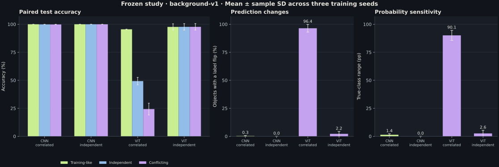
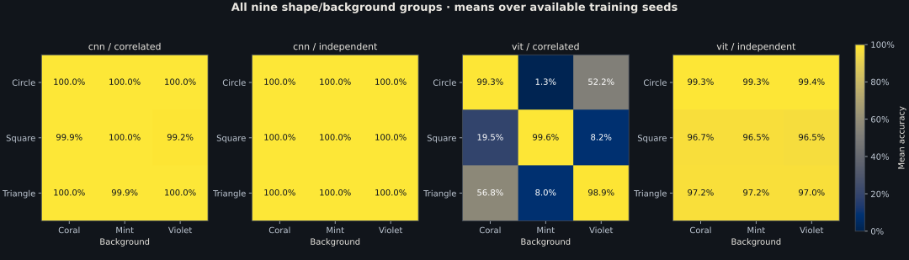

# Results and verification

## Release status

**The complete frozen 12-run study is trained, evaluated and verified.** All runs used commit `880540a` with a clean working tree and the same frozen implementation. Development failures, per-seed results and resource measurements are retained.

| Component | Implementation | Executed verification |
| --- | --- | --- |
| Renderer and background allocation | Complete | Full-size manifests and pixel-level audit passed |
| Split isolation and hashes | Complete | 15,600 unique foregrounds; no cross-split duplicates |
| Metrics and colour-only baseline | Complete | Analytic controls and independent fixtures passed |
| CNN and ViT | Complete | Runtime parameter counts and finite gradients passed |
| Training, checkpoint reload and evaluation | Complete | Round-trip checks and all four smoke runs passed |
| Tiny balanced overfit | Complete | Both models fit 27/27 renders at learning rate 0.0003; the failed 0.003 attempt is preserved |
| Twelve-run study | Complete | All 12 runs, final checkpoints and paired evaluations verified |
| Interactive application | Complete | HTTP handlers and five interface state checks passed |
| Browser rendering and socket HTTP | Complete | Real Chromium desktop/mobile, every checkpoint/seed/background, both training conditions and checkpoint-free mode passed |
| Python distribution | Complete | Wheel and source archive built; installed wheel controls and assets exercised |
| GitHub CI | Configured | No remote workflow result claimed |

## Data evidence

[data-audit.json](../results/data-audit.json) records the renderer identifier, manifest hashes, exact contingency tables and audit results for the candidate full sizes:

- Training: 10,800 objects, 3,600 per shape. Correlated rows contain 3,420 canonical and 90 objects for each other background; independent rows contain 1,200 of each background.
- Validation: 1,800 objects, 600 per shape. Correlated rows contain 570 canonical and 15 objects for each other background; independent rows contain 200 of each background.
- Final-test manifest: 3,000 unique objects, 1,000 per shape. All three backgrounds per object give 9,000 renders. The contingency table counts renders; the object count remains 3,000.
- Every object in all three splits was checked against both alternative backgrounds: 31,200 pixel-exact foreground comparisons. No clipped or empty foregrounds were found.

Training conditions share identical specifications. Target areas are identical across class triplets. Training-set rasterised foreground means were 369.914 pixels for circles, 369.914 for squares and 369.955 for triangles; all classes have 5th–95th percentile areas close to 269–471 pixels. Binary rasterisation introduces perimeter-dependent area error, checked separately from target-area matching.

The renderer uses PCG64 with a separate hashed stream for each split. Foreground RGB is `(240, 240, 230)`. Backgrounds permute `(184, 88, 88)`, keeping arithmetic mean brightness at 120; perceptual luminance is not equalised. All shapes use binary pixel-centre geometry without resizing or antialiasing. These results should not be generalised to arbitrary backgrounds.

[paired-examples.png](../results/paired-examples.png) is actual generated output: demo seed 73, object IDs `demo-73-000000`, `demo-73-000001` and `demo-73-000002`. The demo stream is separate from experiment streams.

## Primary findings

The [complete report](../results/background-v1/REPORT.md) provides per-seed values, all nine shape/background groups, probability sensitivity, percentage-point gaps and training resources. Values below are means ± sample standard deviations across three training seeds, not confidence intervals over individual renders.

| Model / training | Training-like accuracy | Independent accuracy | Conflicting accuracy | Background flip rate |
| --- | --- | --- | --- | --- |
| CNN / correlated | 99.99% ± 0.01 | 99.89% ± 0.12 | 99.83% ± 0.19 | 0.32% ± 0.36 |
| CNN / independent | 100.00% ± 0.00 | 100.00% ± 0.00 | 100.00% ± 0.00 | 0.00% ± 0.00 |
| ViT / correlated | 95.50% ± 0.18 | 49.30% ± 3.34 | 24.32% ± 5.23 | 96.43% ± 3.44 |
| ViT / independent | 97.64% ± 2.78 | 97.68% ± 2.86 | 97.70% ± 2.90 | 2.23% ± 2.17 |

The background-change hypothesis was supported for the tested ViT: correlated training produced a 71.18 pp training-like-to-conflicting accuracy gap, while independent training substantially reduced background sensitivity. The correlated CNN did not exhibit the anticipated collapse. It retained near-perfect accuracy, although its true-class probability range was larger than the independent control's. This negative result for a general shortcut-collapse expectation is retained.

These are bounded results for two small models, one shared recipe and synthetic shapes. Parameter matching does not equalise computation or inductive bias. Independent ViT performance also varied across seeds, so differences cannot be attributed exclusively to architecture-level shortcut mechanisms. Three seeds support a descriptive comparison, not a universal robustness claim.

[Training curves](../results/background-v1/training-curves.json), [full metric records](../results/background-v1/metrics.json), and [integrity verification](../results/background-v1/verification.json) retain the measured evidence. Per-run training took approximately 101–103 seconds for CNNs and 138–141 seconds for ViTs in the recorded environment. Peak allocated GPU tensor memory was 520.35 MiB and 192.86 MiB respectively. These timings include the training/validation epoch loop and exclude cache construction, saving and paired evaluation; shared hardware conditions limit throughput comparisons.

## Metric evidence

The [colour-only control](../results/colour-only.json) predicts the canonical class of each background:

| Metric | Computed value |
| --- | --- |
| Training-like accuracy | 95% |
| Independent-background accuracy | 33⅓% |
| Conflicting-background accuracy | 0% |
| Worst-group accuracy | 0% |
| Background flip rate | 100% |
| Mean true-class probability range | 1.0 |

Tests also check a perfect shape-only rule, a manually calculated asymmetric probability fixture, invalid probability rejection and sample standard deviation across seeds. These are implementation controls, not evidence of neural model learning.

## Automated checks

[verification.json](../results/verification.json) records **22 Python checks and five JavaScript state checks, all passing with no skips**. Checks cover data integrity, cached/direct tensor equality, finite model gradients, reproducibility, checkpoint round trips, independently recomputed metrics, actual socket HTTP, disconnected clients and shared UI/offline inference.

Executed verification used Python 3.10.20, PyTorch 2.13.0 with CUDA 13.0, NumPy 2.2.6, Pillow 12.3.0 and Node.js 22.16.0. CUDA development runs used a Quadro RTX 5000. Both models start with random weights. Runtime parameter counts are 152,823 for the CNN and 150,787 for the ViT, a ratio of 1.0135; model designs are unchanged from the initial candidate.

Real Chromium 134.0.6998.35 checks using Playwright 1.51.0 passed at desktop and mobile sizes. The primary browser check exercises all 12 checkpoints, both training conditions, all three backgrounds and seed selection, comparing displayed probabilities to actual HTTP inference. No JavaScript runtime errors were recorded. Evidence: [primary browser record](../results/browser-study/browser.json), [checkpoint-free record](../results/browser-control/browser.json), [background-intervention capture](../results/browser-study/lab-intervention.png), [canonical capture](../results/browser-study/lab-desktop.png), [mobile capture](../results/browser-study/lab-mobile.png). Captures use fixed demo object `demo-73-000000` and actual seed-0 weights.

The [study verifier](../scripts/verify_study.py) independently read all saved prediction files, checked 108,000 prediction vectors and matching object IDs, recomputed every metric/seed aggregate, and verified all checkpoint hashes and clean frozen provenance. Fresh CPU inference on nine preselected objects per checkpoint agreed with the saved GPU labels for all 324 background predictions. Probabilities were not bitwise identical: the largest measured difference was 0.000692, or 0.0692 percentage points. Published benchmark metrics use the saved GPU predictions; the demo uses CPU inference. Cross-device/batch arithmetic is not promised to be bitwise identical.

The CI workflow requires all checks without skips, then runs tiny overfit, the smoke pipeline and both browser modes. Local execution is verified; no remote GitHub workflow result is claimed.

## Development and smoke results

The [smoke report](../results/smoke/REPORT.md) publishes all four measured two-epoch runs, with per-object prediction hashes, software versions and runtime. Both correlated models learned the background rule (95% training-like accuracy and 0% conflicting accuracy). The independently trained smoke models remained underfit. These smoke values do not support an architecture ranking.

The [development report](../results/development/REPORT.md) and [validation curves](../results/development/validation.json) preserve the learning investigations. The original tiny-overfit setting failed for ViT; the revised shared learning rate passed for both models. On 1,080 development objects, the ViT remained at chance under both batch sizes 128 and 32. Increasing to the planned 10,800 training objects improved its independent validation accuracy to 75.28% at 30 epochs. The selected common 60-epoch schedule passed every 80% gate: CNN 100% in both conditions; ViT 95.11% correlated and 93.28% independent. The model designs, main batch size and main learning rate remain unchanged. No final-study test predictions informed these choices.

## Artifact and release limits

Only small summaries, curves, figures and browser captures are committed. Checkpoints, raw manifests and per-object prediction records remain outside Git; their hashes are published. No public checkpoint download, hosted demo, or successful hosted GitHub CI run is claimed. The local application and reproduction commands have been exercised. Occlusion, attention visualisations, natural-image datasets and architecture sweeps are outside this release.
