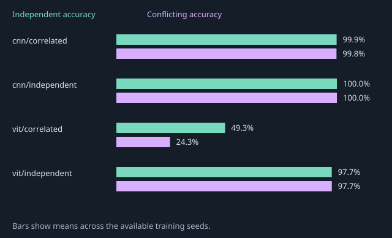

# Measured background intervention results

Protocol: `background-v1`.

Full three-seed matrix complete.

All values below are measured from saved predictions. Accuracy is weighted over paired objects. Standard deviations use training seeds, not individual renders.

| Model / training | Seeds | Training-like | Independent | Conflicting | Worst group | Flip rate |
| --- | --- | --- | --- | --- | --- | --- |
| cnn/correlated | 0, 1, 2 | 99.99% ± 0.01 | 99.89% ± 0.12 | 99.83% ± 0.19 | 99.17% ± 0.95 | 0.32% ± 0.36 |
| cnn/independent | 0, 1, 2 | 100.00% ± 0.00 | 100.00% ± 0.00 | 100.00% ± 0.00 | 100.00% ± 0.00 | 0.00% ± 0.00 |
| vit/correlated | 0, 1, 2 | 95.50% ± 0.18 | 49.30% ± 3.34 | 24.32% ± 5.23 | 1.27% ± 1.21 | 96.43% ± 3.44 |
| vit/independent | 0, 1, 2 | 97.64% ± 2.78 | 97.68% ± 2.86 | 97.70% ± 2.90 | 96.30% ± 3.72 | 2.23% ± 2.17 |

Per-seed metrics, all nine groups, true-class probability ranges, percentage-point gaps, hashes, parameter counts, runtime and software versions are retained in [metrics.json](metrics.json).

Training-like always refers to the 95% correlated distribution, including for the independent control. Three background renders share one object. These results describe the tested configurations and do not establish a universal architecture ranking.

## Accuracy gaps and probability sensitivity

Values are means ± sample standard deviation across training seeds. Gaps and probability ranges are percentage points (pp).

| Model / training | Training-like − independent | Training-like − conflicting | True-class probability range |
| --- | --- | --- | --- |
| cnn/correlated | 0.11 pp ± 0.11 | 0.16 pp ± 0.18 | 1.39 pp ± 0.91 |
| cnn/independent | 0.00 pp ± 0.00 | 0.00 pp ± 0.00 | 0.02 pp ± 0.01 |
| vit/correlated | 46.20 pp ± 3.50 | 71.18 pp ± 5.40 | 90.09 pp ± 4.46 |
| vit/independent | -0.04 pp ± 0.08 | -0.06 pp ± 0.13 | 2.60 pp ± 2.75 |

## Per-seed results

| Model / training | Seed | Training-like | Independent | Conflicting | Worst group | Flip rate | Probability range |
| --- | --- | --- | --- | --- | --- | --- | --- |
| cnn/correlated | 0 | 100.00% | 99.98% | 99.97% | 99.90% | 0.07% | 0.60 pp |
| cnn/correlated | 1 | 100.00% | 99.93% | 99.90% | 99.50% | 0.17% | 1.19 pp |
| cnn/correlated | 2 | 99.98% | 99.74% | 99.62% | 98.10% | 0.73% | 2.38 pp |
| cnn/independent | 0 | 100.00% | 100.00% | 100.00% | 100.00% | 0.00% | 0.01 pp |
| cnn/independent | 1 | 100.00% | 100.00% | 100.00% | 100.00% | 0.00% | 0.02 pp |
| cnn/independent | 2 | 100.00% | 100.00% | 100.00% | 100.00% | 0.00% | 0.03 pp |
| vit/correlated | 0 | 95.60% | 46.21% | 19.52% | 0.00% | 100.00% | 94.49 pp |
| vit/correlated | 1 | 95.61% | 48.83% | 23.55% | 1.40% | 96.17% | 90.19 pp |
| vit/correlated | 2 | 95.29% | 52.84% | 29.90% | 2.40% | 93.13% | 85.58 pp |
| vit/independent | 0 | 94.43% | 94.38% | 94.35% | 92.00% | 4.73% | 5.78 pp |
| vit/independent | 1 | 99.28% | 99.38% | 99.43% | 98.40% | 0.93% | 0.90 pp |
| vit/independent | 2 | 99.21% | 99.28% | 99.32% | 98.50% | 1.03% | 1.13 pp |

## All nine shape/background groups

Each cell is a mean ± sample standard deviation across training seeds. Worst-group accuracy is computed within each seed before aggregation.

| Shape / background | cnn/correlated | cnn/independent | vit/correlated | vit/independent |
| --- | --- | --- | --- | --- |
| circle / coral | 100.00% ± 0.00 | 100.00% ± 0.00 | 99.27% ± 0.76 | 99.33% ± 0.67 |
| circle / mint | 100.00% ± 0.00 | 100.00% ± 0.00 | 1.27% ± 1.21 | 99.33% ± 0.47 |
| circle / violet | 100.00% ± 0.00 | 100.00% ± 0.00 | 52.17% ± 3.65 | 99.40% ± 0.62 |
| square / coral | 99.87% ± 0.06 | 100.00% ± 0.00 | 19.50% ± 4.26 | 96.67% ± 3.96 |
| square / mint | 100.00% ± 0.00 | 100.00% ± 0.00 | 99.57% ± 0.38 | 96.53% ± 3.32 |
| square / violet | 99.17% ± 0.95 | 100.00% ± 0.00 | 8.20% ± 6.63 | 96.47% ± 3.87 |
| triangle / coral | 100.00% ± 0.00 | 100.00% ± 0.00 | 56.80% ± 10.22 | 97.17% ± 4.30 |
| triangle / mint | 99.93% ± 0.12 | 100.00% ± 0.00 | 8.00% ± 8.00 | 97.17% ± 4.21 |
| triangle / violet | 100.00% ± 0.00 | 100.00% ± 0.00 | 98.90% ± 0.44 | 97.03% ± 4.36 |

## Training resources

Runtime covers the training/validation epoch loop. Cache construction, checkpoint saving and paired evaluation are outside that timer. GPU memory is peak allocated tensor memory; it excludes other processes and driver context.

| Model / training | Seed | Parameters | Runtime (s) | Peak GPU (MiB) | Device |
| --- | --- | --- | --- | --- | --- |
| cnn/correlated | 0 | 152,823 | 103.09 | 520.35 | cuda:0 |
| cnn/correlated | 1 | 152,823 | 101.44 | 520.35 | cuda:0 |
| cnn/correlated | 2 | 152,823 | 101.88 | 520.35 | cuda:0 |
| cnn/independent | 0 | 152,823 | 101.82 | 520.35 | cuda:0 |
| cnn/independent | 1 | 152,823 | 102.14 | 520.35 | cuda:0 |
| cnn/independent | 2 | 152,823 | 101.08 | 520.35 | cuda:0 |
| vit/correlated | 0 | 150,787 | 140.15 | 192.86 | cuda:0 |
| vit/correlated | 1 | 150,787 | 140.61 | 192.86 | cuda:0 |
| vit/correlated | 2 | 150,787 | 140.57 | 192.86 | cuda:0 |
| vit/independent | 0 | 150,787 | 139.97 | 192.86 | cuda:0 |
| vit/independent | 1 | 150,787 | 137.68 | 192.86 | cuda:0 |
| vit/independent | 2 | 150,787 | 139.80 | 192.86 | cuda:0 |

The full per-run hardware/software records, source commit, renderer/experiment hashes and checkpoint hashes remain in [metrics.json](metrics.json).
