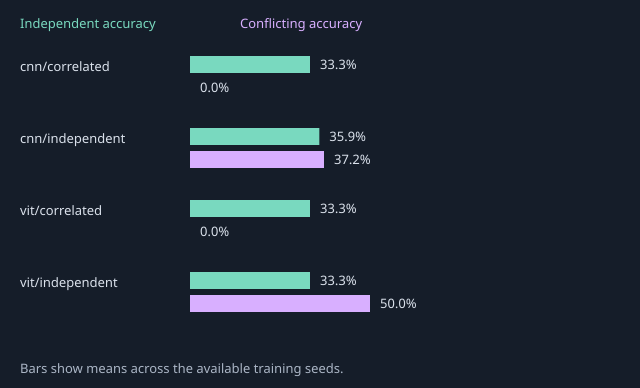

# Measured background intervention results

Protocol: `background-v1-smoke`.

Partial/development evidence; the full three-seed matrix is incomplete.

All values below are measured from saved predictions. Accuracy is weighted over paired objects. Standard deviations use training seeds, not individual renders.

| Model / training | Seeds | Training-like | Independent | Conflicting | Worst group | Flip rate |
| --- | --- | --- | --- | --- | --- | --- |
| cnn/correlated | 0 | 95.00% (one seed) | 33.33% (one seed) | 0.00% (one seed) | 0.00% (one seed) | 100.00% (one seed) |
| cnn/independent | 0 | 33.53% (one seed) | 35.93% (one seed) | 37.22% (one seed) | 0.00% (one seed) | 11.11% (one seed) |
| vit/correlated | 0 | 95.00% (one seed) | 33.33% (one seed) | 0.00% (one seed) | 0.00% (one seed) | 100.00% (one seed) |
| vit/independent | 0 | 2.50% (one seed) | 33.33% (one seed) | 50.00% (one seed) | 0.00% (one seed) | 100.00% (one seed) |

Per-seed metrics, all nine groups, true-class probability ranges, percentage-point gaps, hashes, parameter counts, runtime and software versions are retained in [metrics.json](metrics.json).

Training-like always refers to the 95% correlated distribution, including for the independent control. Three background renders share one object. These results describe the tested configurations and do not establish a universal architecture ranking.
